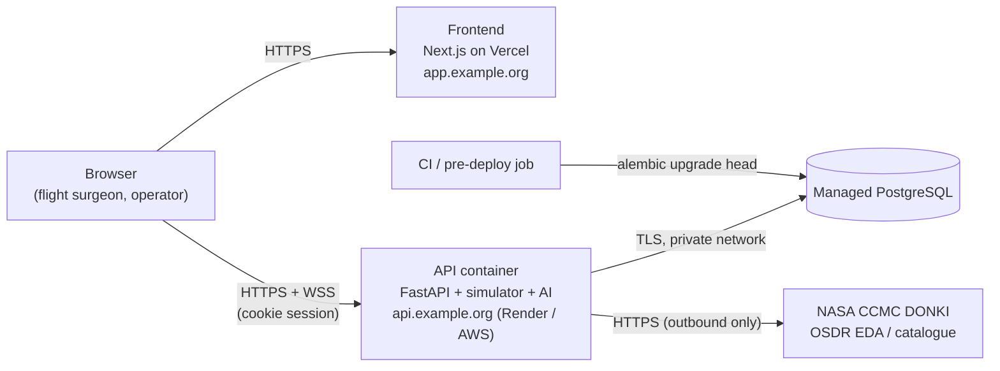

# Production deployment guide

How to run ASTRA-MED outside a laptop. **Nothing has been deployed publicly.** Docker has never run
on the development machine (its engine would not start), and the Render and Vercel configurations
were reviewed against the code but never applied. Treat this guide as a verified *design* with
untested *configuration*, and run the checklist in section 8 before any public URL exists.

## 1. Target architecture



| Component | Recommended | Why |
| --- | --- | --- |
| Frontend | Vercel (or the `frontend/Dockerfile` image anywhere) | Static and client-rendered pages; no server actions or API routes |
| API | One Docker container on Render or AWS (ECS/Fargate, App Runner) | Long-running process: 1 Hz simulator, WebSocket hub, schedulers |
| Database | Managed PostgreSQL 16 with automated backups | `asyncpg` driver; the schema is owned by Alembic |
| AI inference | Inside the API container, in worker threads | Measured at 0.1–0.4 s per request on a laptop CPU ([BENCHMARKS.md](BENCHMARKS.md)), so a separate inference service is not needed yet. The model registry and `ModelBundle` are already isolated behind `AIService`, so splitting it out later is a deployment change, not a rewrite |
| File storage | Not needed today | PDFs are rendered on request, not stored. Model artifacts are baked into the image (`TRAIN_MODELS=1`). If artifacts move out of the image, put them in S3-compatible storage and keep the SHA-256 manifest check |

**Run exactly one API instance.** The simulator, live-stream hub, collectors, sandbox and login
throttle live in the process. Two replicas would duplicate simulated writes and split WebSocket
clients. Disable autoscaling.

## 2. Domain layout: required for sign-in

The session cookie is `HttpOnly; Secure; SameSite=Strict`. Browsers do not send a Strict cookie on
cross-site requests, and `*.vercel.app` and `*.onrender.com` are different sites. So:

- **Do:** serve both from one registrable domain, for example `app.example.org` (Vercel custom
  domain) and `api.example.org` (Render custom domain). These are the same site, so the Strict
  cookie works for REST and for the WebSocket handshake.
- **Don't:** use the default `*.vercel.app` frontend with an `*.onrender.com` API. Login returns 200,
  then every call is 401 and the socket closes with 1008. Relaxing the cookie to `SameSite=None`
  would depend on third-party cookies, which Safari and Firefox block.

## 3. Backend configuration (production)

Start-up refuses an unsafe production configuration (`ASTRA_ENVIRONMENT=production`).

| Setting | Production value | Enforced at start |
| --- | --- | --- |
| `ASTRA_ENVIRONMENT` | `production` | — |
| `ASTRA_DATABASE_URL` | managed PostgreSQL URL (`postgres://…` is accepted and switched to asyncpg) | yes: SQLite is refused |
| `ASTRA_DB_SCHEMA_MODE` | `migrate` | yes |
| `ASTRA_AUTH_ENABLED` | `true` | yes |
| `ASTRA_AUTH_COOKIE_SECURE` | `true` | yes |
| `ASTRA_CORS_ORIGINS` | `https://app.example.org` (explicit list; `*` is refused) | `*` refused; localhost logs a warning |
| `ASTRA_API_DOCS_ENABLED` | unset (docs off in production) or `true` to expose `/docs` | — |
| `ASTRA_NASA_API_KEY` | optional personal api.nasa.gov key, as a platform secret | never logged or returned |
| `ASTRA_AI_MODEL_VERSION` | unset (latest) or a version to pin | — |
| `ASTRA_TRAIN_ON_START` | `false` when the image already contains models | — |
| `FORWARDED_ALLOW_IPS` | the proxy's address range; `*` only if the platform proxy is the sole route to the container | — |

Without `FORWARDED_ALLOW_IPS`, every client appears as the proxy's IP. The login throttle then
becomes one shared bucket that a single attacker can exhaust for everyone, and audit IPs are wrong.

No session secret is needed: sessions are random tokens stored only as SHA-256 digests. Passwords
are hashed with scrypt.

## 4. Build and release

### Images

```bash
# from the repository root
docker build -f backend/Dockerfile -t astra-med-api .                       # trains models during the build (~5 min)
docker build -f backend/Dockerfile --build-arg INSTALL_TORCH=0 -t astra-med-api:slim .   # no PyTorch
docker build -f frontend/Dockerfile --build-arg NEXT_PUBLIC_API_URL=https://api.example.org -t astra-med-web frontend
```

The backend image:

- runs as a non-root user (uid 10001);
- installs the exact versions in `backend/constraints.txt`;
- copies `docs/`, which the assistant cites;
- checks health at `GET /readyz`;
- starts through `scripts/docker-entrypoint.sh`, which runs uvicorn with `--proxy-headers` and
  `--forwarded-allow-ips`.

`NEXT_PUBLIC_API_URL` and `NEXT_PUBLIC_WS_URL` are inlined at build time, so build the frontend once
per environment. `next.config.ts` derives the Content-Security-Policy `connect-src` from the same
values, so a mismatch shows up as blocked requests, not as silent failures.

### Database migrations

```bash
cd backend
alembic upgrade head          # pre-deploy step, once per release (Render: preDeployCommand)
alembic current               # the revision a database is at
alembic upgrade head --sql    # print the SQL for review instead of running it
```

- **Baseline revision `0001`:** creates all 23 tables of phases 1–6. Upgrade, the "no drift" check
  (`alembic check`), downgrade and re-upgrade were verified on PostgreSQL 16 and SQLite.
- **Existing databases** created by earlier phases (no `alembic_version` table): run
  `python scripts/db_adopt.py`. It compares the schema with the models and, with `--stamp`, records
  revision 0001 only if they match exactly. The development PostgreSQL database matched exactly.
- **In migrate mode** the API refuses to start on a database that is not at the newest revision, so
  code and schema cannot drift.

### Render (blueprint `render.yaml`, not applied)

1. Connect the repository and create the blueprint. It defines the `astra-med-api` Docker web
   service (one instance, health check `/readyz`, pre-deploy `alembic upgrade head`) and the
   `astra-med-db` PostgreSQL database.
2. Set the secrets marked `sync: false` in the dashboard: `ASTRA_CORS_ORIGINS` and, optionally,
   `ASTRA_NASA_API_KEY`.
3. Add the custom domain `api.example.org`. Render terminates TLS.
4. Create accounts in the service shell:
   `python scripts/create_users.py add <username> --role flight_surgeon`. The password is prompted
   for and never printed. Never use `create_users.py dev` in production; it is refused there.

### Vercel (frontend)

1. Import the repository with **Root Directory** `frontend`. The framework preset is Next.js.
2. Set `NEXT_PUBLIC_API_URL=https://api.example.org`. `NEXT_PUBLIC_WS_URL` is optional; it defaults to
   `wss://api.example.org/ws/health-monitoring`.
3. Add the custom domain `app.example.org`. Vercel serves HTTPS and adds HSTS; the app's own
   headers add CSP, HSTS, `X-Frame-Options: DENY`, `nosniff` and a Permissions-Policy.
4. Preview deployments get `*.vercel.app` URLs, which are not on the API's CORS list and are not
   same-site. Use them for visual review only, or give previews their own staging API.

### AWS (alternative)

Run the same image on ECS/Fargate or App Runner, with these settings:

- one task;
- an ALB health check on `/readyz` and HTTPS through an ACM certificate;
- RDS PostgreSQL in private subnets;
- `FORWARDED_ALLOW_IPS` set to the ALB subnets;
- a one-off task running `alembic upgrade head` before each service update.

The ALB idle timeout must exceed the WebSocket ping interval; 120 s is enough.

## 5. Health and logging

| Endpoint | Auth | Purpose |
| --- | --- | --- |
| `GET /livez` | none | Liveness: the process answers. Restart on failure |
| `GET /readyz` | none | Readiness: start-up finished and the database answers within 3 s. Returns 503 otherwise, so traffic waits |
| `GET /api/system/health` | none | Summary for the dashboard header (no data) |
| `GET /api/system/status` | signed in | Deep component health: database, simulator, stream, AI models, NASA sources, collectors, sandbox |
| `GET /api/ai/status` | `health:read` | Loaded model version, pin, library mismatch, inference latency per operation |

Logs are line-oriented on stdout: timestamp, level, `astra.*` logger and message, with a request ID
per request that is also returned in `X-Request-ID`. Query strings, request bodies, passwords,
session tokens and bound SQL parameters (`hide_parameters=True`) are never logged.

## 6. Rollback

| What | How | Data impact |
| --- | --- | --- |
| Application | Redeploy the previous image or commit (Render: "Rollback" on a previous deploy; ECS: previous task definition) | None, if the schema did not change |
| Schema | `alembic downgrade -1`, run **before** rolling the code back, and only after a backup or snapshot | Downgrades drop what the revision added |
| AI models | Set `ASTRA_AI_MODEL_VERSION=<previous version>` and restart, or call `POST /api/ai/models/reload` as an administrator | None. Versions are immutable and hash-verified |
| Database | Restore the managed database's point-in-time backup | Loses writes after the restore point |

Take a database snapshot before every release that contains a migration.

## 7. Local stack (Docker Compose)

```bash
cp .env.example .env                  # set POSTGRES_PASSWORD
docker compose up --build             # PostgreSQL, API (migrates, trains models once), dashboard
docker compose exec backend python scripts/create_users.py dev   # local demo accounts only
```

Compose binds every port to 127.0.0.1, runs migrations on start and keeps trained models in a
volume. It is a local stack over plain HTTP, not a production layout. **Untested here** because
Docker does not run on the development machine. Without Docker, use
`python scripts/local_postgres.py serve` (verified).

## 8. Pre-launch checklist

- [ ] Frontend and API on one registrable domain, both HTTPS.
- [ ] `ASTRA_ENVIRONMENT=production`; the API starts, so the production checks passed.
- [ ] `alembic current` shows the head revision; a database backup exists.
- [ ] `FORWARDED_ALLOW_IPS` set; the audit log shows real client IPs after a test sign-in.
- [ ] `ASTRA_CORS_ORIGINS` lists only the production frontend origin.
- [ ] Accounts created with `create_users.py add`; no demo accounts.
- [ ] `/readyz` is green; `/api/system/status` shows every component OK.
- [ ] A sign-in, the live stream and a sandbox run work from the public URL.
- [ ] The dashboard shows the "simulated data" marker and the not-a-medical-device notice.
- [ ] Only one API instance; autoscaling off.
