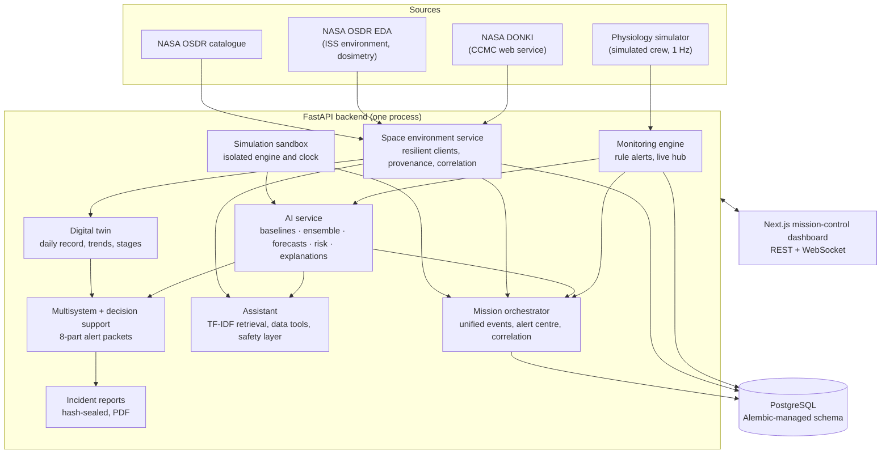
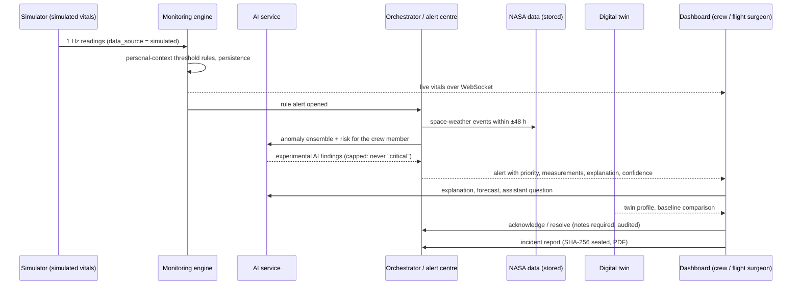
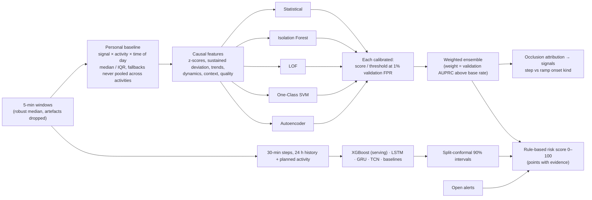

# ASTRA-MED: an explainable, personalised health-monitoring prototype for long-duration crewed missions

*Technical research document, NASA Space Apps Challenge 2026, challenge "Create Health Monitoring
Software for Astronauts on Space Missions". Version of 2026-11-14.*

> **Status of the evidence.** ASTRA-MED is a research prototype. Every crew measurement in it is
> generated by a simulator; the crew are fictional. NASA space-weather and ISS environment data are
> real and are used as context only. All quantitative results below are from simulated data and
> describe how well the methods recover the simulator's own injected events. Nothing here is
> clinically validated, and no output is a diagnosis or a treatment recommendation. ASTRA-MED is
> not affiliated with or endorsed by NASA.

## 1. Abstract

On missions to the Moon and Mars, the crew will increasingly have to notice health changes
themselves, with delayed or intermittent help from the ground. ASTRA-MED is an open-source
prototype that turns streams of physiological indicators into reviewable evidence. It provides:

- a personal baseline for every crew member, per activity and time of day;
- an ensemble of five anomaly detectors with calibrated thresholds;
- 1–24 h forecasts with distribution-free prediction intervals;
- transparent rule-based risk scoring;
- a digital twin of each crew member's record;
- a cited, safety-constrained assistant;
- one mission-control view that puts all of this next to real NASA space-weather (DONKI) and ISS
  environment (OSDR) data.

Every alert carries its measurements, a comparison with the person's own baseline, an attribution
to the signals that drove it, a confidence statement and its data provenance.

The evaluation used a 120-day simulated dataset with chronological splits and three independent
replications:

- **Anomaly detection:** learned detectors reached F1 0.62–0.81 at a 1 % false-positive rate,
  against 0.36 for fixed alert thresholds.
- **Forecasting:** gradient-boosted forecasts cut 1-hour heart-rate error to 2.19 ± 0.16 bpm, from
  3.85 ± 0.28 bpm for a personal-climatology baseline.
- **Intervals:** 90 % conformal intervals covered 89–91 % of outcomes.

We also report negative results. The ensemble was not reliably better than its best member, and
neural forecasters did not beat gradient boosting. The validation steps still needed before any
clinical use are listed in section 14.

## 2. Problem statement

Long-duration missions expose crews to five hazards identified by NASA's Human Research Program:
space radiation, isolation and confinement, distance from Earth, altered gravity fields, and a
hostile closed environment [21]. They are associated with cardiovascular changes, immune changes,
bone loss, behavioural health problems and other risks [3, 5, 9]. On the ISS, a flight surgeon on
the ground watches over the crew in near real time. On a Mars mission, communication delays of
several minutes each way, and periods without contact, shift that responsibility onto the crew
[3, 5]. The 2026 Space Apps challenge asks for software that gathers health indicators and helps
astronauts evaluate and act on their health status [22].

The specific problem ASTRA-MED addresses is **interpretation under uncertainty**. A raw value such
as a heart rate of 104 bpm means different things for different people, during exercise or at
rest, and before or after a radiation event. Fixed alarm thresholds either fire constantly or miss
slow deteriorations. Black-box predictions cannot be trusted by a crew that must act on them alone.

## 3. Research motivation

- **Personalisation.** Physiological responses to spaceflight vary between individuals. The NASA
  Twins Study documented multisystem changes in one astronaut compared with his ground-based twin [1].
  A useful monitor compares a crew member with themselves, not with a population norm.
- **Explainability and provenance.** Decision support that cannot show *why* it flagged something,
  or *which data* it used, cannot be checked by a medically trained crew member. Simulated, measured,
  modelled and estimated values must never be confused, especially for radiation, where a solar flare
  is an *indicator*, not a dose [2, 6].
- **Honest uncertainty.** Forecasts need intervals with a stated, checkable coverage, not single
  numbers.
- **Data reality.** Astronaut vital-sign time series are not publicly available; NASA's Life
  Sciences Data Archive holds crew data under restricted access. Any open prototype must therefore
  separate what it can demonstrate on simulated data from what still needs real-data validation.

## 4. Existing approaches and their limitations

| Approach | Strength | Limitation for autonomous crews |
| --- | --- | --- |
| Fixed physiological alarm thresholds | Simple, transparent | Not personal or context-aware. In our evaluation they missed 77 % of anomalous windows at a similar false-positive rate (section 13) |
| Unsupervised anomaly detection (Isolation Forest, LOF, One-Class SVM, autoencoders) [10–13] | No labels needed; finds unusual combinations | Raw scores are hard to interpret and calibrate; each has different failure modes |
| Deep sequence forecasting (LSTM, GRU, TCN) [14–16] | Flexible | Data-hungry; often not better than tuned trees on tabular-like features; opaque |
| Gradient-boosted trees [17] | Strong on engineered features; fast; explainable with TreeSHAP [19] | Needs careful features and leakage control [25, 26] |
| Digital twins [7, 8] | Integrate data into one model of a system or person | In medicine, mostly organ-level research models; "twin" is often used loosely |
| Clinical early-warning scores | Validated in hospitals | Validated on hospital patients, not healthy crews in microgravity |

ASTRA-MED combines these pieces. Its contribution is integration, transparency and an honest
evaluation design, not a new algorithm.

## 5. Proposed architecture

The backend is a single asynchronous Python service. CPU-heavy model work runs in worker threads, so
the 1 Hz monitoring loop is never blocked. All shapes are defined once in Pydantic, exported as
OpenAPI, and compiled into the frontend's TypeScript types, so the user interface cannot silently
drift from the API. Access is permission-based across four roles: flight surgeon, mission
operator, analyst and administrator. There are server-side sessions, CSRF protection and an audit
log of every read of crew data.

## 6. System methodology: from a reading to a reviewed incident

Design rules enforced in code and tests:

1. **Every value has a data category.** The categories are measured, indicator, model, estimate,
   simulated, derived and regenerated. The interface shows the category; categories are never
   summed or converted into each other. For example, a flare is never turned into a dose.
2. **Experimental AI never escalates on its own.** AI findings are capped below "critical" and below
   the highest alert priority, and are labelled experimental.
3. **Simulation is isolated.** The mission sandbox has its own engine and clock and writes only to
   its own tables. Sandbox items carry a "[SIM]" prefix.
4. **Every explanation statement traces to an input.** A test checks that each number in a
   multisystem explanation belongs to a listed input.

## 7. Data acquisition

| Data | Source | Use |
| --- | --- | --- |
| Crew physiology (HR, SpO₂, BP, temperature, respiratory rate, ECG, HRV, sleep, activity, dose) | ASTRA-MED simulator, **simulated** | The monitored signals |
| Solar flares, CMEs, SEP events, geomagnetic storms, radiation-belt enhancements, notifications, WSA-ENLIL runs | NASA DONKI [27], **real**, 3,296 events stored (2014-09-17 to 2026-11-13) | Environmental indicators around alerts; correlation; timeline |
| ISS cabin temperature, humidity, CO₂; absorbed dose (GCR, SAA) | NASA OSDR Environmental Data App [28], **real**, 17 missions 2014–2024 | Measured environment and dose context |
| Space-biology study metadata | NASA OSDR [20, 29], **real** | Research context in the data explorer and assistant |
| Mars-cruise dose-equivalent rate, 1.84 mSv/day | MSL RAD [2] | Cited estimate and the simulator's background rate |

The full inventory, with licences, units, processing steps and limitations, is in
[DATASETS.md](DATASETS.md). NASA clients retry with backoff, honour `Retry-After` and switch
endpoints through a circuit breaker. On 2026-11-12 and 2026-11-14 the api.nasa.gov DONKI proxy
returned HTTP 404, and ASTRA-MED served DONKI from the CCMC origin. Records are validated, versioned
and stored with their raw form.

## 8. AI/ML methodology

- **Personal baselines.** Each signal has one cell per activity state (sleep, rest, work, exercise)
  and 4-hour time-of-day bucket. A cell keeps running statistics and a 600-value reservoir, from
  which come a robust centre (median), a robust scale (IQR/1.349 with a per-signal floor) and
  percentiles. A thin cell falls back to its whole activity, never to a pool across activities, so
  an ordinary first workout is not scored against rest values.
- **Anomaly detection.** Five complementary detectors [10–13] are trained on clean training windows.
  Each threshold is set on validation-normal windows for a 1 % false-alarm rate. The ensemble
  averages the calibrated scores of members whose validation AUPRC is at least 80 % of the best,
  weighted by AUPRC above the base rate. Each detector chooses its feature set on validation AUPRC.
- **Explanations.** Occlusion attribution [18] replaces one feature at a time with its reference
  value: 0 in z-space, or the training median. The score changes are summed per signal. Since
  phase 7 this is computed in one batch per detector, 2.1× faster with identical output. XGBoost
  forecast drivers use TreeSHAP [19].
- **Forecasting.** Forecasts cover 1, 6, 12 and 24 h in 30-minute steps from 24 h of history and
  the planned activity schedule. Split-conformal intervals [23, 24] are calibrated on a dedicated
  split, and their coverage is measured on the test split, not assumed.
- **Risk scoring.** Transparent point rules in a JSON file add up baseline deviation (with a duration
  factor), ensemble score, forecast crossings and open alerts. The values are prototype settings,
  not clinical criteria.
- **Assistant.** TF-IDF retrieval [30] runs over the project documentation and the ingested NASA
  records, together with typed data tools. Every statement cites a record or a verbatim passage.
  Diagnosis and treatment questions are declined, and escalation notices are raised for critical
  situations.

## 9. Space-environment intelligence

Radiation information is kept in four labelled categories, never converted into one another:

- **A, measured:** EDA absorbed dose, mGy/day.
- **B, indicators:** DONKI events.
- **C, estimate:** the MSL cruise rate, mSv/day.
- **D, simulated:** crew dose.

DONKI severity is assigned only where the record contains the defining quantity:

- flares use the NOAA R scale from peak X-ray flux;
- storms use the NOAA G scale from Kp;
- CMEs use a speed class;
- SEP events stay unclassified because DONKI carries no flux [31].

The correlation engine computes lagged correlations between simulated crew signals and environmental
series. It accounts for autocorrelation and controls the false discovery rate across lags
(Benjamini–Hochberg [34]). It explicitly reports that a correlation with a simulated signal says nothing
about real physiology.

## 10. Digital-twin architecture

"Digital twin" is used here in the systems-engineering sense of a continuously updated record of one
entity [7], not as a physiological simulation of a person; compare cardiology twins [8]. Per crew
member, ASTRA-MED keeps:

- one row per mission day: per-signal statistics, sleep, activity, dose, alerts, scenarios and
  coverage;
- a current state from the live stream;
- baseline comparisons with their basis (configured, early-mission, last 7 days, last 24 h, learned);
- longitudinal trends: OLS slope with an autocorrelation-adjusted confidence interval;
- mission-stage comparisons with Welch intervals;
- the real NASA events of the same date.

Days that retention has pruned are deterministically regenerated and labelled `regenerated`.
Six-system assessments (cardiovascular, respiratory, thermoregulation, sleep, activity and recovery,
radiation indicators) use statistical bands at |z| ≥ 2 and ≥ 3. Cross-system co-deviations are
labelled "co-occurrence, not a cause".

## 11. Experimental methodology

- **Dataset.** 120 simulated days, 4 crew members, 5-minute windows (138,240 windows, fingerprint
  `eabfda075aa4`). It contains 327 injected events: sudden, gradual and subtle, of ten types. Missing
  data and artefact spikes are added, and the artefacts are deliberately not labelled anomalies.
- **Splits.** Chronological, day-aligned 60/20/20 [26]. Baselines and scalers are fitted on clean
  training data only; features are causal; forecast targets never cross a split boundary [25].
- **Selection.** Thresholds, feature sets, ensemble weights and early stopping all use validation
  data. The test split is scored once per run.
- **Replication.** The whole pipeline was rerun on two further independently generated datasets
  (seeds 11 and 23), and results are reported as mean ± standard deviation over the three runs.
- **Reproducibility.** Runs are versioned with their config hash, dataset fingerprint, git commit,
  library versions and per-file SHA-256. Retraining the same configuration two days apart reproduced
  every metric exactly.
- **Engineering evaluation.** Latency and throughput were measured on a 2-million-row PostgreSQL
  history with 50 concurrent WebSocket clients, and AI inference with interleaved before/after runs
  ([BENCHMARKS.md](BENCHMARKS.md)).

## 12. Evaluation metrics

- **Window level:** precision, recall, F1, AUROC, AUPRC (preferred under class imbalance [32]),
  false-positive rate and false-negative rate.
- **Event level:** share of events detected and detection delay.
- **Operational:** false warnings per crew-day when a warning needs 10 minutes of persistence.
- **Forecasts:** MAE, RMSE, MAPE for ratio-scale signals only, empirical coverage of 90 % intervals,
  and skill relative to personal climatology. MAPE is not used for temperature in °C, whose zero is
  arbitrary [33].

## 13. Results

Results are on the simulated test split; the full tables are in
[SCIENTIFIC_VALIDATION.md](SCIENTIFIC_VALIDATION.md).

| Anomaly detection (3 datasets) | F1 | AUROC | False-positive rate | False-negative rate | Events detected |
| --- | --- | --- | --- | --- | --- |
| Fixed thresholds (baseline) | 0.357 ± 0.080 | 0.774 ± 0.021 | 0.0063 | 0.767 | 58 % |
| Isolation Forest | 0.616 ± 0.047 | 0.941 ± 0.008 | 0.0097 | 0.514 | 88 % |
| Local Outlier Factor | 0.811 ± 0.029 | 0.960 ± 0.007 | 0.0075 | 0.270 | 93 % |
| Ensemble | 0.800 ± 0.052 | 0.962 ± 0.011 | 0.0094 | 0.271 | 94 % |

| Heart-rate forecast (3 datasets) | MAE 1 h | MAE 24 h | Coverage of 90 % interval |
| --- | --- | --- | --- |
| Personal climatology | 3.85 ± 0.28 bpm | 3.85 ± 0.28 bpm | 0.892 |
| LSTM | 3.05 ± 0.18 bpm | 3.66 ± 0.22 bpm | 0.909 |
| XGBoost | **2.19 ± 0.16 bpm** | **3.15 ± 0.25 bpm** | 0.904 |

**Findings.**

1. Personal, learned detection clearly outperforms fixed thresholds on this data.
2. The ensemble's advantage over LOF alone is within run-to-run variation.
3. Gradient boosting beats the neural forecasters by several standard deviations.
4. The intervals are well calibrated.

In an end-to-end demonstration against the live PostgreSQL deployment, a simulated developing
desaturation went from first readings to a sealed incident report in all ten steps
([demo transcript](demo/demo-run.md)). Those steps were detection, AI analysis, twin update, a live
NASA DONKI synchronisation, environmental context, an explainable alert, a cited assistant summary
and the mission-control display. Engineering results: SQL time bucketing made 7-day history queries
6.7× faster, and batched attribution made anomaly explanations 2.1× faster, both with identical
outputs.

## 14. Limitations

- **Simulated data only.** The simulator, the injected events and the labels share one design, which
  makes detection easier than in reality. No result here establishes real-world accuracy.
- **No real-data validation.** Validation tiers 2–4 (retrospective real data, analogue missions,
  clinical evaluation) have not been done ([SCIENTIFIC_VALIDATION.md §1](SCIENTIFIC_VALIDATION.md)).
- **Plan equals reality.** Planned activity equals actual activity in the simulator, which flatters
  the forecasters.
- **Missing indicators.** Indicators the challenge names, such as blood glucose and mood, are not
  yet modelled, and the interface is built for mission control more than for the astronaut's own
  self-assessment.
- **Near-Earth vantage.** DONKI events are observed from near Earth; their relevance to a spacecraft
  elsewhere is not modelled.
- **Single process.** The prototype runs as one process with one database.

## 15. Future research directions

1. **Real-data validation.** Retrospective validation on real physiological recordings under
   appropriate data-use agreements, starting with analogue-mission or isolation-study data.
2. **Clinical calibration.** Thresholds calibrated with clinicians without labelled anomalies, and
   alarm-burden studies with crews in analogue habitats.
3. **Astronaut self-assessment.** A self-assessment mode for the crew member: prompted measurements,
   manual indicators (glucose, mood, symptoms) and plain-language guidance tied to approved
   procedures.
4. **Geometry-aware radiation context.** Radiation context that accounts for spacecraft position
   and shielding, using detector data such as RadLab.
5. **On-board operation.** Federated or on-board model updates under bandwidth limits, and a
   tamper-evident record.

## 16. References

PubMed-indexed references were checked against PubMed on 2026-11-14 (PMID given). The others are
standard references whose bibliographic details were checked by the authors. Web pages were checked
live on 2026-11-14.

1. Garrett-Bakelman FE, *et al.* The NASA Twins Study: a multidimensional analysis of a year-long human spaceflight. *Science* 364(6436):eaau8650, 2019. doi:10.1126/science.aau8650. PMID 30975860.
2. Zeitlin C, *et al.* Measurements of energetic particle radiation in transit to Mars on the Mars Science Laboratory. *Science* 340(6136):1080–1084, 2013. doi:10.1126/science.1235989. PMID 23723233.
3. Patel ZS, *et al.* Red risks for a journey to the red planet: the highest priority human health risks for a mission to Mars. *npj Microgravity* 6:33, 2020. doi:10.1038/s41526-020-00124-6. PMID 33298950.
4. Afshinnekoo E, *et al.* Fundamental biological features of spaceflight: advancing the field to enable deep-space exploration. *Cell* 183(5):1162–1184, 2020. doi:10.1016/j.cell.2020.10.050. PMID 33242416.
5. Stepanek J, Blue RS, Parazynski S. Space medicine in the era of civilian spaceflight. *N Engl J Med* 380(11):1053–1060, 2019. doi:10.1056/NEJMra1609012. PMID 30865799.
6. Cucinotta FA, Durante M. Cancer risk from exposure to galactic cosmic rays: implications for space exploration by human beings. *Lancet Oncol* 7(5):431–435, 2006. doi:10.1016/S1470-2045(06)70695-7. PMID 16648048.
7. Glaessgen E, Stargel D. The digital twin paradigm for future NASA and U.S. Air Force vehicles. 53rd AIAA/ASME/ASCE/AHS/ASC Structures, Structural Dynamics and Materials Conference, 2012. doi:10.2514/6.2012-1818.
8. Corral-Acero J, *et al.* The "Digital Twin" to enable the vision of precision cardiology. *Eur Heart J* 41(48):4556–4564, 2020. doi:10.1093/eurheartj/ehaa159. PMID 32128588.
9. Lee AG, *et al.* Spaceflight associated neuro-ocular syndrome (SANS) and the neuro-ophthalmologic effects of microgravity: a review and an update. *npj Microgravity* 6:7, 2020. doi:10.1038/s41526-020-0097-9. PMID 32047839.
10. Liu FT, Ting KM, Zhou Z-H. Isolation forest. *Proc. IEEE ICDM*, 413–422, 2008. doi:10.1109/ICDM.2008.17.
11. Breunig MM, Kriegel H-P, Ng RT, Sander J. LOF: identifying density-based local outliers. *Proc. ACM SIGMOD*, 93–104, 2000. doi:10.1145/342009.335388.
12. Schölkopf B, Platt JC, Shawe-Taylor J, Smola AJ, Williamson RC. Estimating the support of a high-dimensional distribution. *Neural Computation* 13(7):1443–1471, 2001.
13. Chandola V, Banerjee A, Kumar V. Anomaly detection: a survey. *ACM Computing Surveys* 41(3):15, 2009.
14. Hochreiter S, Schmidhuber J. Long short-term memory. *Neural Computation* 9(8):1735–1780, 1997.
15. Cho K, *et al.* Learning phrase representations using RNN encoder–decoder for statistical machine translation. *Proc. EMNLP*, 1724–1734, 2014.
16. Bai S, Kolter JZ, Koltun V. An empirical evaluation of generic convolutional and recurrent networks for sequence modeling. arXiv:1803.01271, 2018.
17. Chen T, Guestrin C. XGBoost: a scalable tree boosting system. *Proc. ACM KDD*, 785–794, 2016. doi:10.1145/2939672.2939785.
18. Zeiler MD, Fergus R. Visualizing and understanding convolutional networks. *Proc. ECCV*, LNCS 8689, 818–833, 2014.
19. Lundberg SM, *et al.* From local explanations to global understanding with explainable AI for trees. *Nature Machine Intelligence* 2:56–67, 2020.
20. Berrios DC, Galazka J, Grigorev K, Gebre S, Costes SV. NASA GeneLab: interfaces for the exploration of space omics data. *Nucleic Acids Res* 49(D1):D1515–D1522, 2021. doi:10.1093/nar/gkaa887. PMID 33080015.
21. NASA Human Research Program. 5 Hazards of Human Spaceflight; Risks of Human Spaceflight. https://www.nasa.gov/hrp/hazards/ and https://www.nasa.gov/hrp/risks/ (accessed 2026-11-14).
22. NASA Space Apps Challenge 2026. Create Health Monitoring Software for Astronauts on Space Missions. https://www.spaceappschallenge.org/2026/challenges/health-monitoring-software/ (accessed 2026-11-14).
23. Vovk V, Gammerman A, Shafer G. *Algorithmic Learning in a Random World*. Springer, 2005.
24. Lei J, G'Sell M, Rinaldo A, Tibshirani RJ, Wasserman L. Distribution-free predictive inference for regression. *J Am Stat Assoc* 113(523):1094–1111, 2018.
25. Kaufman S, Rosset S, Perlich C, Stitelman O. Leakage in data mining: formulation, detection, and avoidance. *ACM TKDD* 6(4):15, 2012.
26. Bergmeir C, Benítez JM. On the use of cross-validation for time series predictor evaluation. *Information Sciences* 191:192–213, 2012.
27. NASA CCMC. DONKI: Space Weather Database Of Notifications, Knowledge, Information. https://ccmc.gsfc.nasa.gov/tools/DONKI/ (accessed 2026-11-14).
28. NASA OSDR. Environmental Data App. https://visualization.osdr.nasa.gov/eda/ (accessed 2026-11-14).
29. NASA Open Science Data Repository. https://osdr.nasa.gov/bio/repo/ (accessed 2026-11-14).
30. Salton G, Buckley C. Term-weighting approaches in automatic text retrieval. *Information Processing & Management* 24(5):513–523, 1988.
31. NOAA Space Weather Prediction Center. NOAA Space Weather Scales. https://www.swpc.noaa.gov/noaa-scales-explanation (accessed 2026-11-14).
32. Saito T, Rehmsmeier M. The precision-recall plot is more informative than the ROC plot when evaluating binary classifiers on imbalanced datasets. *PLoS One* 10(3):e0118432, 2015. doi:10.1371/journal.pone.0118432. PMID 25738806.
33. Hyndman RJ, Koehler AB. Another look at measures of forecast accuracy. *Int J Forecasting* 22(4):679–688, 2006.
34. Benjamini Y, Hochberg Y. Controlling the false discovery rate: a practical and powerful approach to multiple testing. *J R Stat Soc B* 57(1):289–300, 1995.
